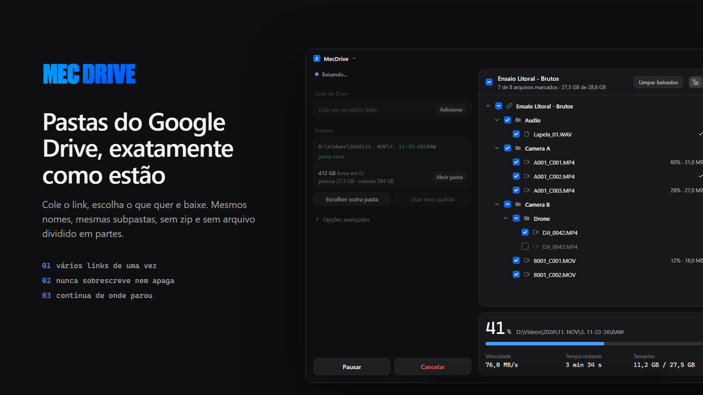

<p align="center">
  
</p>

# MecDrive

App de Windows para baixar pastas e arquivos do Google Drive exatamente como estão: mesmos nomes, mesmas subpastas, sem zip e sem a divisão em partes que o Drive faz em downloads grandes. O motor de transferência é o [rclone](https://rclone.org).

## Baixar

Na página de [Releases](https://github.com/hugomec7/MecDrive/releases/latest):

| Arquivo | Para quem |
| --- | --- |
| `MecDrive_x.y.z_x64-setup.exe` | Instalador. Instala só para o seu usuário, sem pedir administrador. Os dados ficam em `%APPDATA%\MecDrive`. |
| `MecDrive_x.y.z_portable.zip` | Portátil. Extraia em qualquer pasta e abra `MecDrive.exe`. Os dados ficam na pasta `data` ao lado do exe. |

Precisa do WebView2, que já vem no Windows 10 e 11.

No primeiro uso o app pede login no Google. O login é feito pelo rclone no seu navegador, com acesso somente leitura, e é necessário mesmo para pastas públicas.

## O que faz

- Aceita um ou vários links (pasta ou arquivo), mostra a árvore com os tamanhos e você marca o que quer
- Nunca sobrescreve nem apaga nada no destino: arquivo com o mesmo tamanho é pulado, com tamanho diferente é avisado e não é tocado
- Continua de onde parou se o app fechar ou a conexão cair
- Subpasta, prefixo e sufixo nos nomes, manter ou não a pasta raiz do link, downloads simultâneos
- Troca caracteres que o Windows não aceita em nomes (uma pasta `11/22/26` vira `11-22-26`)
- Mostra o espaço livre do disco de destino antes de baixar
- Progresso por arquivo e geral, pausar, cancelar, histórico, aviso de versão nova
- Opcional: sugere a pasta do dia no padrão `<base>\<ano>\<n>. <MÊS>\<n>. MM-DD-AA\RAW`, olhando as pastas que já existem

## Pelo terminal

O `mecdrive-cli.exe` vem junto e usa o mesmo login e as mesmas regras do app.

```
mecdrive-cli status
mecdrive-cli list "https://drive.google.com/drive/folders/ID"
mecdrive-cli download "https://drive.google.com/drive/folders/ID" --dest "D:\Videos\RAW"
mecdrive-cli download "LINK" --dest "D:\Videos\RAW" --only Camera --dry-run
mecdrive-cli help
```

Com `--json` cada evento sai em uma linha JSON (`plan`, `progress`, `file`, `done`), o que facilita o uso por scripts e por agentes como o Claude Code. O repositório traz um [CLAUDE.md](CLAUDE.md), um [AGENTS.md](AGENTS.md) e uma skill em [.claude/skills/mecdrive](.claude/skills/mecdrive/SKILL.md).

## Montar a partir do código

Precisa de Rust (MSVC) e Node.

```
powershell -ExecutionPolicy Bypass -File tools\get-rclone.ps1
cd src-tauri
cargo build --release
npx @tauri-apps/cli@2 build
```

O primeiro comando baixa o `rclone.exe` oficial para `bin\` e confere o SHA256. O `cargo build` gera `MecDrive.exe` e `mecdrive-cli.exe` em `src-tauri\target\release`, e o último comando gera o instalador em `src-tauri\target\release\bundle\nsis`. `tools\make-portable.ps1` monta o zip portátil.

## Estrutura

- `src-tauri/src/main.rs`: sobe o `rclone rcd`, repassa chamadas rc e faz as operações de disco
- `src-tauri/src/bin/mecdrive-cli.rs`: linha de comando
- `src-tauri/src/shared.rs`: o que os dois usam (pasta de dados, API do Drive, limpeza de nomes)
- `ui/`: interface e fila de downloads (`app.js`)
- `tools/`: scripts de build e de teste

## Créditos

Feito por @hugoeditor_. As transferências são feitas pelo [rclone](https://github.com/rclone/rclone) (licença MIT), distribuído junto sem modificações. Veja [THIRD-PARTY.md](THIRD-PARTY.md).
